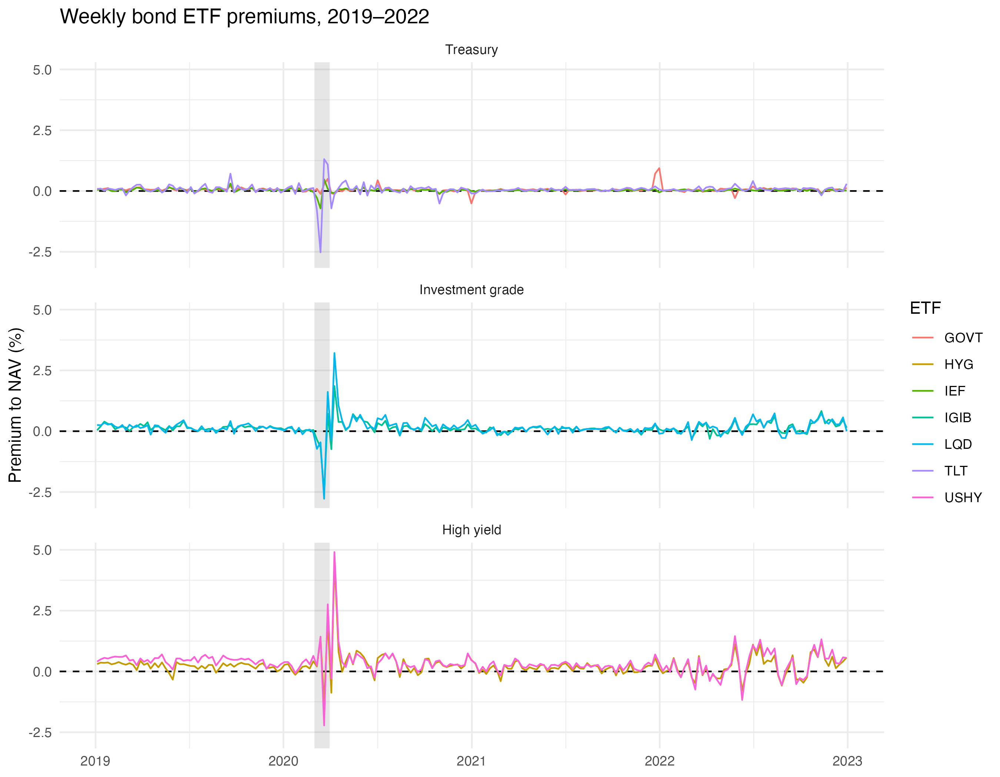
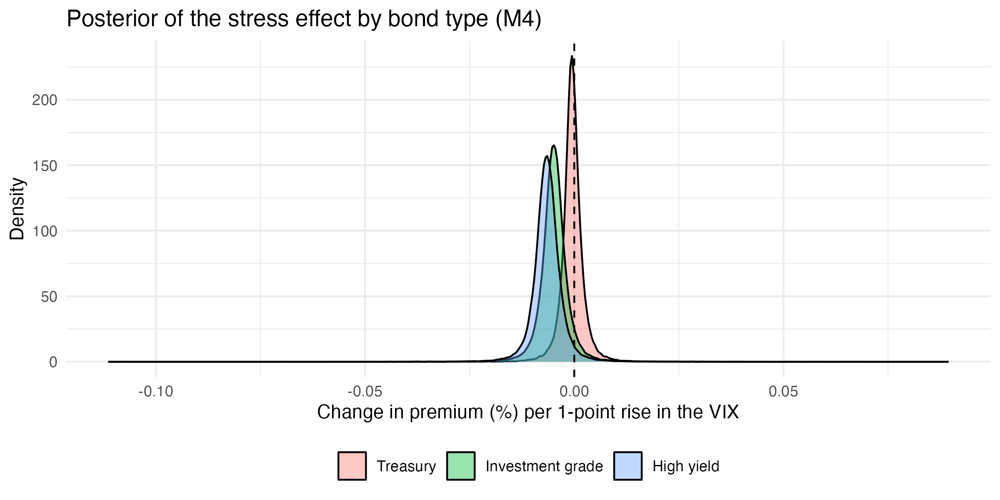
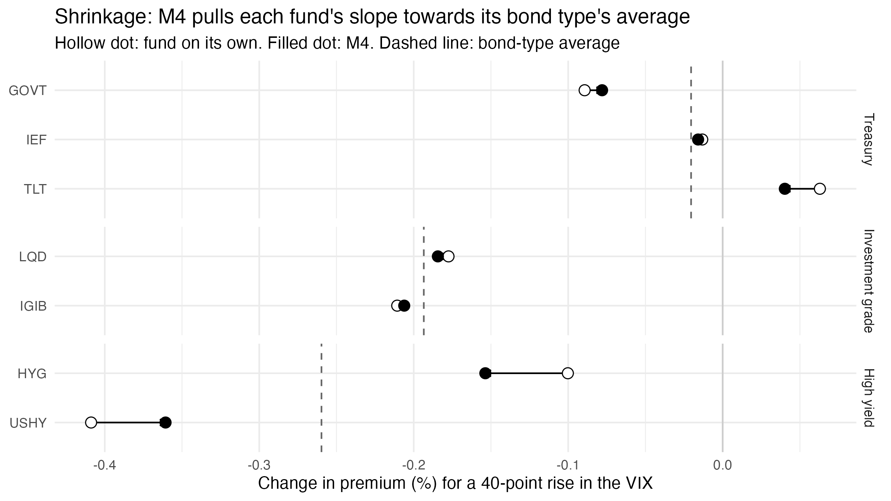

# Is the Price Wrong, or the NAV?

**A hierarchical Bayesian analysis of bond ETF premiums under market stress**

Cúán Quinlan and Ryan O’Donnell · ST417 Bayesian Modelling · University of Galway · November 2026

When a bond ETF trades away from the value of the bonds it holds (its NAV), is the market price wrong, or is the NAV out of date? On 19 March 2020, LQD, one of the largest US investment-grade corporate bond ETFs, closed 5% below its NAV. Days later, after the Federal Reserve said it would buy corporate bonds and bond ETFs, the same funds traded at premiums of 3–5%. This project uses Bayesian hierarchical models, fitted by MCMC in R and JAGS, to measure how market stress moves these gaps and which side closes them.



## Questions

1. How does market stress, measured by the VIX, move ETF premiums, and does the effect differ by bond type?
2. When a gap opens, does the NAV catch up the following week (a stale NAV) or does the price come back (a wrong price)?

## Key findings

- **Stress lowers corporate premiums, but only slightly.** A 40-point rise in the VIX, roughly March 2020, lowers investment-grade premiums by about 0.19% and high-yield premiums by about 0.26% (posterior probability of a negative effect 0.94 and 0.97). Treasury premiums don’t move. That is small next to the 2–5% swings seen in the crisis.
- **Gaps close fast.** Corporate premium gaps have a half-life of about 3 trading days; Treasury gaps are gone within the week.
- **The answer to the title is both.** The NAV closes 40–60% of a corporate fund’s gap the following week, so NAVs are partly stale and the price does the rest.
- **Crisis discounts are rare, fat-tailed shocks,** not a steady effect of the VIX: the Student-t degrees of freedom are about 1.6.

| Bond type | Effect of a 40-point VIX rise (95% interval) | P(effect < 0) | Half-life of a gap | Share of a gap the NAV closes next week, γ (95% interval) |
|---|---|---|---|---|
| Treasury | −0.02% (−0.24 to 0.21) | 0.61 | within the week | 0.33 (−0.06 to 0.94) |
| Investment grade | −0.19% (−0.47 to 0.09) | 0.94 | 0.60 weeks (0.48 to 0.70) | 0.57 (0.27 to 0.92) |
| High yield | −0.26% (−0.54 to 0.03) | 0.97 | 0.52 weeks (0.45 to 0.68) | 0.38 (0.10 to 0.54) |

## Data

Seven iShares bond ETFs in three bond types, weekly (last trading day of each week), January 2019 to December 2022.

| Bond type | Funds |
|---|---|
| Treasury | GOVT, IEF, TLT |
| Investment grade | LQD, IGIB |
| High yield | HYG, USHY |

- **NAVs:** each fund’s historical data file from its iShares web page (`data/raw/nav_*.csv`).
- **Closing prices and the VIX (`^VIX`):** Yahoo Finance, downloaded with `quantmod`.
- **Training set:** 2019–2021, 1,099 fund-weeks (7 funds × 157 weeks), including the March 2020 crisis. **Test set:** 2022, 364 fund-weeks.
- **Variables:**

$$\text{premium}_{j,t} = 100 \times \frac{P_{j,t} - \text{NAV}_{j,t}}{\text{NAV}_{j,t}}, \qquad \text{VIX}^c_t = \text{VIX}_t - 21.0,$$

$$\Delta\text{NAV}_{j,t+1} = 100 \times \frac{\text{NAV}_{j,t+1} + D_{j,t+1} - \text{NAV}_{j,t}}{\text{NAV}_{j,t}},$$

where $P$ is the closing price, 21.0 is the mean VIX over the training weeks, and $D$ is any dividend paid, added back so a payout isn’t read as a fall in value.

## Methods

**Exploratory analysis** showed three things: stress spreads premiums out in both directions; the tails are much fatter than a Normal distribution allows; and, outside the crisis weeks, corporate premiums are correlated about 0.4 with the previous week while Treasury premiums are not.

**Models.** Four models of the weekly premium $y_{jt}$ of fund $j$ in week $t$, each fixing a problem with the last:

| Model | What it adds |
|---|---|
| M1 | Pooled regression on the centred VIX, Normal errors |
| M2 | Last week’s premium; coefficients by bond type |
| M3 | Hierarchical: each fund’s VIX slope is drawn around its bond type’s average |
| **M4 (main)** | M3 with Student-t errors |

The main model, with $k(j)$ the bond type of fund $j$:

$$y_{jt} \sim t_\nu(\mu_{jt}, \sigma), \qquad \mu_{jt} = b_{0j} + b_{1j}\,\text{VIX}^c_t + b_{2,k(j)}\,y_{j,t-1}, \qquad b_{1j} \sim N(\mu_{b,k(j)}, \sigma_b^2).$$

$\mu_{b,k}$ is the stress effect for bond type $k$ (question 1), $b_{2,k}$ is persistence, giving the half-life $\ln 0.5 / \ln b_{2,k}$, and $\nu$ measures tail heaviness. For question 2, a second model regresses next week’s NAV change on this week’s premium:

$$\Delta\text{NAV}_{j,t+1} \sim t_\nu\big(a_k + \gamma_k\,y_{jt},\ \sigma_N\big).$$

$\gamma_k = 1$ means the NAV closes the whole gap (a stale NAV); $\gamma_k = 0$ means the NAV doesn’t move, so the price was wrong. A robustness version adds next week’s change in the VIX.

**Priors** are weakly informative: centred on no-arbitrage (premiums of 0) or, for persistence, near the exploratory estimate: $b_{0j} \sim N(0, 0.5^2)$, $\mu_{b,k} \sim N(0, 0.1^2)$, $\sigma_b \sim U(0, 0.1)$, $b_{2,k} \sim N(0.5, 0.25^2)$, $\tau = 1/\sigma^2 \sim \text{Gamma}(1, 0.25)$, $\nu \sim \text{Gamma}(2, 0.1)$, and $\gamma_k \sim N(0, 0.5^2)$. A prior predictive check showed plausible values but a noise prior that is too wide; refits with 10× vaguer and with strongly informative priors move the stress effects and persistence by at most 0.03.

**Fitting and checking.**

- MCMC in JAGS, with 3 chains per model from different starting values (for the main model, 5,000 burn-in and 60,000 draws per chain).
- Two checks from first principles: a Normal–Gamma conjugate model of calm vs stressed weeks, and our own Gibbs sampler for M1, which matched JAGS to 3 decimal places.
- Convergence: the worst Gelman–Rubin statistic across all nine fits is 1.007 and the smallest effective sample size is 4,326.
- Model choice by DIC: M1 923, M2 786, M3 778, **M4 −1,025**. Student-t errors win clearly, and they fix two odd results in the Normal models caused by a few crisis weeks.
- Posterior predictive checks on the training data pass. On the 2022 test set, M4’s forecast errors are 12–29% smaller than a naive “same as last week” forecast.





## Limitations and next steps

- **One noise level for every fund.** M4’s 2022 90% intervals covered 99% of Treasury weeks but only 48% of high-yield weeks. A next step is a noise level that grows with the VIX and differs by bond type.
- **One crisis.** March 2020 is the only crisis in the training data; modelling the Fed’s intervention directly would help.
- **Weekly data.** Daily extremes such as LQD’s −5.08% on 19 March 2020 are missed; refitting on daily data is a natural extension.

## Repository structure

```
R/
  01_get_data.R              download prices and the VIX (Yahoo) and read the iShares NAV files
  02_clean_data.R            premiums, weekly data, train/test split, next week's NAV change
  03_eda.R                   exploratory figures
  04_conjugate.R             Normal–Gamma conjugate model: calm vs stressed weeks
  05_gibbs.R                 our own Gibbs sampler for M1
  06_fit_jags.R              M1–M3 in JAGS, with DIC
  06b_nav_model.R            second model (does the NAV catch up?), robustness and Student-t versions
  06c_fit_m4.R               main model M4
  06d_convergence_summary.R  convergence table and trace plots
  07_compare_check.R         model comparison, posterior summaries, half-life, shrinkage, prior predictive check
  07b_prior_sensitivity.R    no-pooling model and prior sensitivity refits
  08_predict.R               posterior predictive checks, 2022 test, crisis scenario
models/                      JAGS model files (m1–m4, no-pooling and sensitivity versions)
data/raw/                    iShares NAV files and downloaded Yahoo data
data/processed/              weekly modelling dataset (etf_weekly.rds)
output/figures/              all figures
output/tables/               all result tables (CSV)
output/*.rds                 saved MCMC draws and DIC objects
AI_USE.md                    dated log of how AI was used
```

## Reproducing the analysis

1. Install [R](https://www.r-project.org/) and [JAGS 4](https://mcmc-jags.sourceforge.io/), then the R packages:

   ```r
   install.packages(c("tidyverse", "quantmod", "rjags", "coda"))
   ```

2. Open `Bond-ETFs-Bayes.Rproj` in RStudio so paths are relative to the project folder.
3. Run the scripts in `R/` in numerical order. `01_get_data.R` downloads the Yahoo data; the iShares NAV histories are read from `data/raw/nav_*.csv`, downloaded from each fund’s iShares page.
4. The saved MCMC draws in `output/` let `07_compare_check.R` and `08_predict.R` run without refitting the models.

## Data sources and AI use

NAV data are from iShares (BlackRock) and price data from Yahoo Finance; they are included only so the coursework can be reproduced, and remain subject to their providers’ terms. How AI tools were used in this project is logged in [`AI_USE.md`](AI_USE.md).
